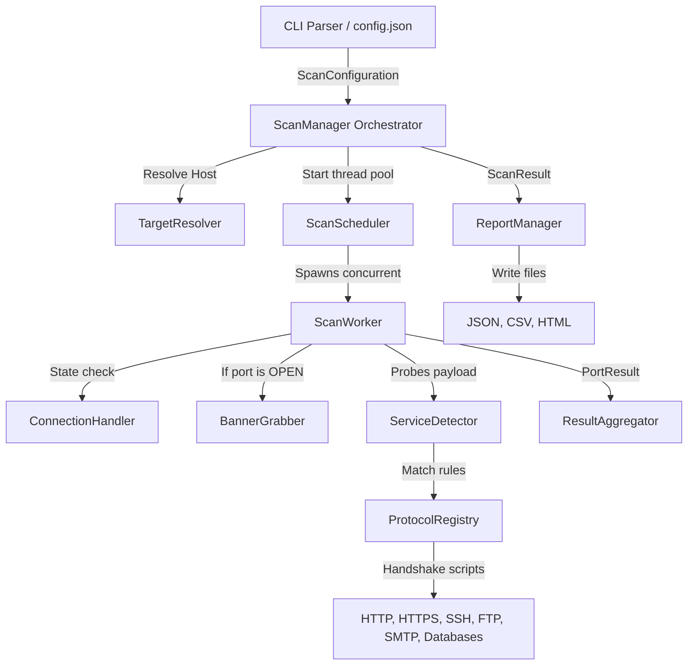

# Software Architecture: PortFootprint

This document details the architectural layout, modules, execution flows, and key design patterns used in **PortFootprint**, a modular cross-platform TCP Port Scanner and Service Fingerprinting CLI tool.

---

## 1. Architectural Layers & Separation of Concerns

PortFootprint is designed using **Clean Architecture** patterns. Core business logic is completely isolated from presentation wrappers, third-party loggers, and format exporters.

```
┌────────────────────────────────────────────────────────┐
│                        cli/                            │
│  (CommandLineParser, TerminalFormatter, Progress)      │
└───────────┬────────────────────────────────────────────┘
            │ instantiates ScanConfiguration
            ▼
┌────────────────────────────────────────────────────────┐
│                        core/                           │
│  (ScanManager, ScanResult, ScanConfiguration)          │
└───────────┬────────────────────────────────────────────┘
            │ orchestrates execution
            ▼
┌────────────────────────────────────────────────────────┐
│                      scanner/                          │
│  (TargetResolver, ConnectionHandler, ScanScheduler)    │
└───────────┬────────────────────────────────────────────┘
            │ executes connections
            ▼
┌────────────────────────────────────────────────────────┐
│                      services/                         │
│  (BannerGrabber, ServiceDetector, ProtocolRegistry)    │
└────────────────────────────────────────────────────────┘
```

* **Presentation Layer (`cli/`)**: Translates CLI flags into typed variables, displays console progress indicators, and formats text-table results.
* **Orchestration Layer (`core/`)**: Coordinates target resolution, scheduler execution, file exporting, and scans history logs tracking.
* **Scanning Layer (`scanner/`)**: Handles IP domain resolution, non-blocking socket checks, concurrent thread execution, and timeout/retry management.
* **Fingerprinting Layer (`services/`)**: Pulls raw welcome strings and performs application handshakes to detect software names and versions.

---

## 2. Dynamic Component Pipeline

The scan execution flow moves sequentially through specialized modules using decoupled contracts:



---

## 3. Core Directory Structure

Below is the directory tree highlighting the key files in the repository:

```text
portfootprint/
│
├── .github/workflows/ci.yml       # Automated GitHub Actions validation pipeline
├── docs/                          # Detailed technical documentation subpages
├── tests/                         # Complete unit and integration test suite
│
├── portfootprint/                 # Main source package
│   ├── main.py                    # Top-level main runner entrypoint
│   │
│   ├── cli/                       # Terminal parsing and output layout formatting
│   │   ├── formatter.py           # Renders ASCII output tables and comparison diffs
│   │   ├── parser.py              # Declares command-line arguments and validations
│   │   └── progress.py            # Console-based progress bars
│   │
│   ├── common/                    # Shared validation helpers
│   │   ├── logging.py             # Configures verbose console and file loggers
│   │   ├── network.py             # Retrieves local outbound IP routes
│   │   └── validation.py          # Validates IPv4/IPv6 target structures
│   │
│   ├── core/                      # Data models, history logs, and orchestrator
│   │   ├── config.py              # ScanConfiguration frozen validation dataclass
│   │   ├── orchestrator.py        # ScanManager coordination engine
│   │   ├── history.py             # Appends run histories to local JSON stores
│   │   ├── models.py              # Dataclasses (PortResult, HostResult, ScanResult)
│   │   └── statistics.py          # Computes durations and protocol speed metrics
│   │
│   ├── reports/                   # Report output generators
│   │   ├── registry.py            # dynamic registry tracking exporters
│   │   ├── html_report.py         # Generates interactive responsive HTML dashboards
│   │   └── report_manager.py      # Manages directories creation and exports
│   │
│   ├── scanner/                   # Socket connection managers and thread schedulers
│   │   ├── connection.py          # connect_ex connect loops with retry sleeps
│   │   ├── resolver.py            # IPv4, IPv6, and hostname DNS validation
│   │   └── scheduler.py           # ThreadPoolExecutor execution queue
│   │
│   └── services/                  # Protocol discovery and service detectors
│       ├── detector.py            # ServiceDetector querying registries
│       ├── banner.py              # Active/passive welcome headers parsing
│       └── protocols/             # Handshake definitions (HTTP, SSH, Databases...)
```

---

## 4. Key Design Patterns

1. **Registry Pattern**:
   * **ProtocolRegistry**: Dynamically registers service fingerprinting modules using decorators (`@register_protocol`). 
   * **ExportRegistry**: Dynamically registers report formats using decorators (`@register_exporter`).
2. **Strategy Pattern**:
   * Every protocol handshake inherits from `BaseFingerprintModule` and overrides `.fingerprint(sock, target, port, timeout)`.
   * Every report exporter inherits from `BaseReportExporter` and overrides `.export(scan_result, output_path)`.
3. **Facade Pattern**:
   * `ScanManager` provides a simplified, single API call `.execute()` that hides the complexity of Target Resolver, Thread Schedulers, Result Aggregators, and Report Exporters.
