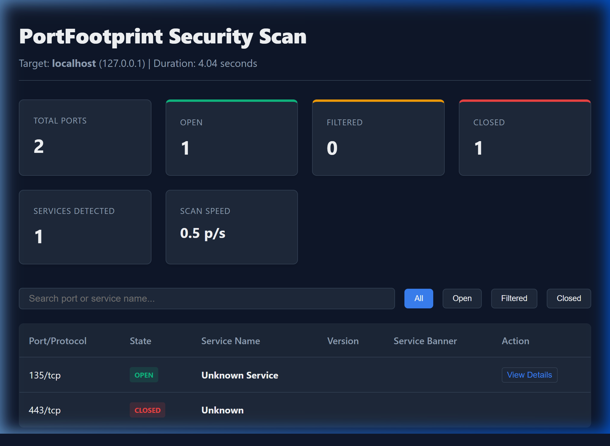

# PortFootprint

PortFootprint is a production-grade, highly modular, cross-platform TCP port scanner and service fingerprinting command-line interface (CLI) tool implemented entirely in standard Python. 

This repository implements **Phase 1**, **Phase 2**, and **Phase 3** of the design, providing a stable multi-threaded scanning core, a modular service discovery and protocol fingerprinting engine, and professional reporting, statistics, history, comparison, and CLI enhancements.

---

## Overview

PortFootprint operates purely within user-space socket APIs, ensuring it runs reliably on Windows, macOS, and Linux without requiring root or administrator privileges. Designed using **Clean Architecture** and **SOLID** principles, it separates concern layers so the framework can be easily integrated into larger environments.

---

## Features Implemented

### Phase 1: Concurrency Core
- **Robust DNS lookup**: Validates targets and handles IPv4/IPv6 name resolutions.
- **Port specification parser**: Supports ranges (`20-80`), comma-separated lists (`22,80,443`), duplicates checking, and automatic sorting.
- **Multi-threaded scanning engine**: Executes TCP Connect scans concurrently via a configurable `ThreadPoolExecutor`.
- **Socket timeouts & retries**: Customizable parameter settings per port connection request.
- **Dynamic visual indicators**: Thread-safe terminal progress status updates.

### Phase 2: Service Discovery & Probes
- **Active/Passive Banner Grabbing**: Reads initial socket welcome strings; falls back to sending safe ASCII probes if silent.
- **Dynamic Protocol Registry**: Implements a registry pattern allowing fingerprint modules to self-register mapping port matches, priority, and banner keywords.
- **Independent Protocol Modules**: HTTP, HTTPS/TLS, SSH, FTP, SMTP, DNS, IRC, and Databases (MySQL, PostgreSQL, Redis, MongoDB).
- **Safe Decoding**: Unicode exceptions trap falling back from UTF-8 to Latin-1 safely.

### Phase 3: Reporting & Operational Enhancements
- **Dynamic Export Registry**: Dynamically dispatch to exporters based on requested report extensions.
- **Professional Exporters**:
  - **JSON Report**: Comprehensive structured JSON layout containing target details, statistics, and detailed service certificate/header dictionaries.
  - **CSV Report**: Flattened spreadsheet-ready CSV listings.
  - **HTML Report**: Responsive, interactive single-file HTML reports containing summary cards, quick search filters, dark-mode styling, and collapsible details showing protocol-specific handshake data.
- **Performance & Protocol Metrics**: Computes average scan speeds (ports per second), service detection counts, and identifies the top protocol.
- **Execution History Manager**: Saves scan metrics in local history log databases (`.portfootprint_history.json`).
- **Differential Scan Comparison**: Allows comparing two JSON reports (`--compare old.json new.json`) to discover new open ports, closed ports, and updated service version changes.
- **Flexible Configuration Files**: Bypasses defaults using `config.json` parameters.
- **Structured File Logging**: Support thread names, log levels, timestamps, and log file outputs.

---

## Requirements

- **Python Version**: Python 3.8 or higher.
- **External Dependencies**: Zero external runtime requirements (standard library only).

---

## Installation

Clone this repository and run the scanner directly using Python:

```bash
# Clone the repository
git clone https://github.com/username/PortFootprint.git
cd PortFootprint
```

To run local testing validation suites, install the development dependencies:

```bash
# Install development dependencies
pip install -r requirements.txt
```

---

## Complete CLI Command Cheat Sheet

Here is a progressive list of scanner execution commands, ordered from basic diagnostics to the most complex combinations:

### 1. Basic System Diagnostics
* Check command line options and help menu details:
  ```bash
  python main.py --help
  ```
* Output current framework release version:
  ```bash
  python main.py --version
  ```

### 2. Standard Scans
* Scan a target hostname using default top ports:
  ```bash
  python main.py scanme.nmap.org
  ```
* Scan a raw IP address target directly:
  ```bash
  python main.py 127.0.0.1
  ```

### 3. Custom Ports Selection
* Scan a single custom port:
  ```bash
  python main.py localhost -p 80
  ```
* Scan multiple comma-separated ports:
  ```bash
  python main.py localhost -p 22,80,443,8080
  ```
* Scan an inclusive range of ports:
  ```bash
  python main.py localhost -p 20-100
  ```
* Scan a mixed list containing both individual ports and port ranges:
  ```bash
  python main.py localhost -p 21-25,80,443,8080-8090
  ```

### 4. Performance Settings
* Scan using a customized concurrency thread limit:
  ```bash
  python main.py localhost --threads 50
  ```
* Scan with customized connection timeout thresholds (in seconds):
  ```bash
  python main.py localhost --timeout 1.5
  ```
* Scan with customized connection retry attempts on socket failure:
  ```bash
  python main.py localhost --retries 2
  ```
* Scan in verbose mode to print debug timestamps and active thread logs:
  ```bash
  python main.py localhost --verbose
  ```

### 5. Structured Exporter Reports
* Generate a single JSON report:
  ```bash
  python main.py localhost --json my_scan.json
  ```
* Generate a flat CSV spreadsheet table:
  ```bash
  python main.py localhost --csv my_scan.csv
  ```
* Generate an interactive responsive dark-mode HTML dashboard:
  ```bash
  python main.py localhost --html my_scan.html
  ```
* Save all supported output files automatically using shortcuts:
  ```bash
  python main.py localhost --all-reports
  ```
* Log execution tracking streams to a customized file path:
  ```bash
  python main.py localhost --log-file scan.log
  ```

### 6. Operational & Comparative Controls
* Print the local scans history index list:
  ```bash
  python main.py --history
  ```
* Compare two scan results to check for differences/state changes:
  ```bash
  python main.py --compare old_scan.json new_scan.json
  ```

### 7. Complex & Lengthy Integrated Command
* Run a high-speed scan on a target host querying a mixed list of ports with custom timeouts, retries, verbose logs, outputting all report files, and saving debug logs:
  ```bash
  python main.py scanme.nmap.org -p 21,22,25,80,100-200,443,3306,8080 --threads 60 --timeout 1.2 --retries 2 --verbose --json report.json --csv report.csv --html report.html --log-file activity.log
  ```

---

## Console & Report Preview

For quick verification, snapshots of command executions and HTML dashboards are saved in the project:

* **Interactive HTML Report**: The scanner outputs an interactive, responsive HTML report dashboard with built-in dark-mode:
  
  

* **CLI Scan Output**: View the terminal table output of a port scan in [cli_scan_output.txt](docs/snapshots/cli_scan_output.txt).
* **CLI Scan History**: View the local scans execution log index in [cli_history_output.txt](docs/snapshots/cli_history_output.txt).
* **CLI Comparison Diff**: View the differences check log in [cli_compare_output.txt](docs/snapshots/cli_compare_output.txt).

---

## Configuration File Guide

An optional `config.json` can be placed in the current directory to override default configurations:

```json
{
    "threads": 50,
    "timeout": 1.5,
    "retries": 2,
    "verbose": false,
    "log_file": "scan.log",
    "default_reports": {
        "json": "report.json",
        "html": "report.html"
    }
}
```

---

## Architecture Design

PortFootprint utilizes decoupled layers to enforce separation of concerns:

- **cli/**: Parses terminal instructions, prints real-time progress, and displays formatted service details and comparisons.
- **core/**: Manages orchestrators, config loaders, statistics estimators, history logs, and comparisons.
- **scanner/**: Controls hostname lookups, port list parsing, socket connections (`connect_ex`), and thread pool workers.
- **services/**: Manages passive/active banner grabbing, registry candidate lookups, and specialized protocol fingerprinters.
- **reports/**: Formats and exports JSON, CSV, and premium interactive HTML reports via an ExportRegistry.
- **common/**: Shared validation rules, path cleaners, and standard log initializers.

---

## Current Limitations

- **TCP Connect Scans Only**: Performs a complete 3-way handshake on connections, which is slower and more detectable than raw SYN scans.
- **Host Discovery**: Assumes the target host is active; does not perform pre-scan ping scans.

---

## Roadmap

- **Phase 1**: Core TCP scanner, CLI validation, thread pooling, and progress formatting. *(Completed)*
- **Phase 2**: Implement deep passive/active banner grabbing and service detection mappings. *(Completed)*
- **Phase 3**: Professional reporting, statistics metrics, execution history logs, scan comparisons, and configuration file. *(Completed)*
- **Phase 4**: Develop advanced vulnerability integration plugins or dynamic plugin loaders.

---

## Disclaimer

This software is developed strictly for educational purposes, security research, and authorized auditing. Do not execute scans against systems without explicit permission from the target owner. The authors and maintainers assume no liability for unauthorized usage or secondary damages.
