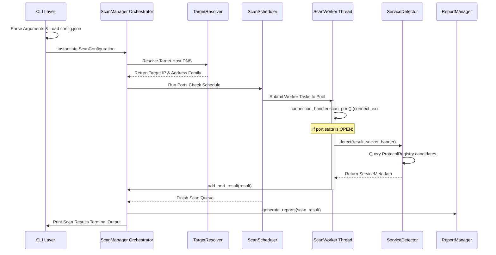

# Execution Flow

This document details the dynamic execution steps from initialization to final outputs formatting.

## Standard Scanning Flow

## Key Phases

### 1. Startup & Config Load
Loads defaults from `config.json` configuration blocks, prioritizing command-line flags.

### 2. Resolution Check
Resolves hostname using `socket.getaddrinfo`. If it resolves, proceeds with the scan; otherwise, reports error.

### 3. Execution Threads Loops
Executes port scans in parallel using `concurrent.futures.ThreadPoolExecutor`.

### 4. Compilations and Reporting
Summarizes counts, records scan history logs locally, and exports requested file formats.
